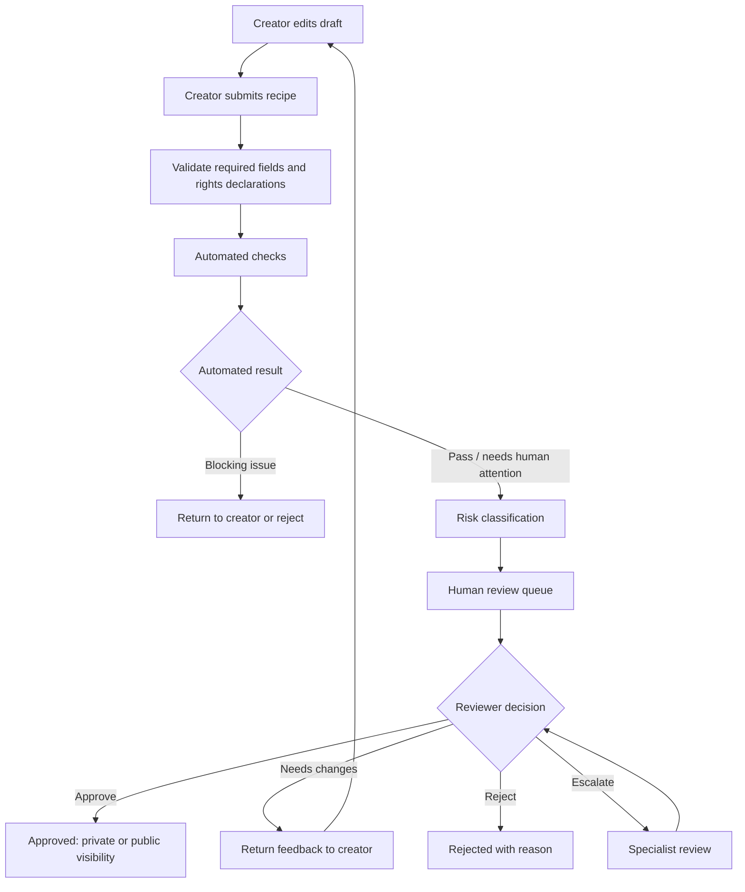

# 05 — Recipe Review and Moderation

## 1. Governing rule

Every user-created recipe submission must pass automated checks and human review before it can become an approved recipe. There is no private-recipe exception that bypasses human review.

A draft may exist as an incomplete working copy. A draft is not an approved recipe and must not appear in public discovery or be treated as verified content.

## 2. Recommended workflow

Automated checks may detect issues and recommend routing. They cannot approve or publish.

## 3. Recipe states

| State | Meaning | Publicly discoverable? |
|---|---|---|
| `draft` | Editable, not submitted | No |
| `submitted` | Submitted and awaiting checks/review | No |
| `automated_blocked` | Blocking validation issue | No |
| `pending_human_review` | Awaiting human decision | No |
| `needs_changes` | Creator must revise | No |
| `approved_private` | Human-approved but private | No |
| `published` | Human-approved and public | Yes |
| `rejected` | Submission rejected | No |
| `restricted` | Temporarily or permanently restricted | No |
| `withdrawal_pending` | Creator withdrawal request under review/notice | Depends on policy and risk |
| `withdrawn` | No longer distributed as active content | No |

A recipe revision submitted after approval should create a new immutable version and may require review based on change severity. Material changes to ingredients, allergens, steps, safety claims, media, or rights should trigger re-review.

## 4. Automated review checks

### Structural validation
- title and description;
- ingredient list with normalized ingredient IDs where possible;
- quantities and units;
- ordered steps;
- serving count;
- preparation/cooking time;
- cuisine and meal classification;
- media metadata and file constraints.

### Quality and integrity
- duplicate or near-duplicate detection;
- spam, abuse, and prohibited content detection;
- malformed or contradictory instructions;
- implausible ingredient quantities;
- missing steps or ingredients referenced but not listed;
- unsupported health/nutrition claims.

### Rights checks
- creator ownership/authorization declaration;
- separate image/video rights declaration;
- suspicious copied text or known rights complaints;
- source/provenance completeness.

Automated similarity flags are signals for human review, not proof of infringement.

### Safety checks
- known allergens derived from normalized ingredients;
- cross-contact warnings where applicable;
- high-risk preparation patterns;
- food-safety temperature/time claims;
- dangerous or non-food substances;
- medical, therapeutic, or disease-treatment claims.

The system must not infer absence of allergens from missing metadata.

## 5. Risk tiers

| Tier | Example indicators | Required route |
|---|---|---|
| Low | Ordinary recipe, complete structure, no elevated safety/rights signals | Standard human review |
| Medium | Missing context, unusual quantities, potential allergen ambiguity, uncertain media provenance | Enhanced human review |
| High | Serious food-safety concern, medical claim, rights complaint, hazardous ingredient, suspected deliberate abuse | Specialist review and possible restriction |

Risk tiers determine review depth and specialist involvement. They do not remove the human-review requirement.

## 6. Human reviewer checklist

### Culinary quality
- Is the recipe coherent and reproducible?
- Are ingredients referenced in the steps?
- Are quantities and units plausible?
- Are cooking times and equipment reasonable?
- Are substitutions clearly labeled?

### Safety
- Are allergens correctly derived from ingredients?
- Are high-risk foods handled with appropriate instructions?
- Are unsafe or unsupported claims removed or escalated?
- Is a specialist needed?

### Rights
- Is creator declaration complete?
- Are media rights independently declared?
- Is there a credible complaint or source conflict?
- Is escalation to rights reviewer required?

### Community standards
- Is the content abusive, discriminatory, spam, or deceptive?
- Does it contain personal information that should not be public?
- Is attribution accurate?

## 7. Roles and segregation of duties

| Role | Capabilities |
|---|---|
| Creator | Create drafts, submit, revise, view decisions, request withdrawal |
| Moderator | Review community standards and spam |
| Culinary reviewer | Review recipe quality and cooking safety |
| Rights reviewer | Review ownership, licensing, and asset provenance |
| Content manager | Manage editorial policy and escalations |
| Admin | Manage roles/configuration; cannot silently bypass audit controls |

Controls:
- creator cannot approve their own submission;
- one reviewer should not approve a content item they authored;
- sensitive actions require reason codes;
- high-risk decisions may require two-person approval;
- all role changes and decisions are audited.

## 8. Review outcomes

Every decision must include:
- status;
- reviewer ID;
- timestamp;
- reason code;
- human-readable feedback;
- affected recipe version;
- required actions;
- appeal/re-submission path where applicable.

## 9. Appeals and reports

Creators should be able to request reconsideration of a rejection or restriction. Appeals should be reviewed by someone other than the original decision-maker where practical.

Users should be able to report:
- inaccurate or unsafe instructions;
- allergy/safety issues;
- copyright or media-rights concerns;
- impersonation;
- harassment or prohibited content.

Urgent safety and rights reports require a rapid restriction path while investigation is pending.

## 10. Operational metrics

- median and 95th-percentile review time;
- submissions per reviewer;
- approval, revision, and rejection rates;
- appeal overturn rate;
- urgent restriction time;
- repeat violation rate;
- safety incident rate;
- rights complaint rate;
- reviewer disagreement rate.

Do not optimize only for approval speed; track quality and incident outcomes.
