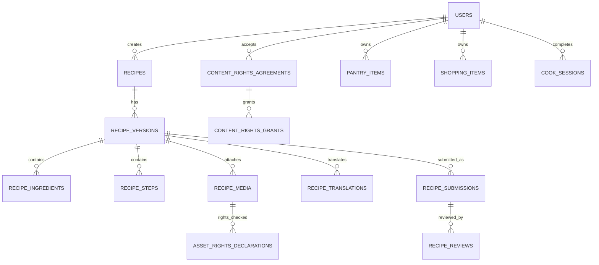

# 08 — Proposed Data Model

> This is a target design. Compare it with the current Drift schema and backend schema before creating migrations.

## 1. Core entities

### Catalog
- `ingredients`
- `ingredient_names`
- `ingredient_substitutes`
- `recipes`
- `recipe_versions`
- `recipe_ingredients`
- `recipe_steps`
- `recipe_tags`
- `recipe_media`
- `recipe_translations`

### Community and review
- `creator_profiles`
- `recipe_submissions`
- `recipe_reviews`
- `moderation_actions`
- `moderation_reports`
- `review_assignments`
- `recipe_ratings`
- `recipe_cooking_outcomes`

### Rights
- `content_rights_agreements`
- `content_rights_grants`
- `content_reserved_rights`
- `asset_rights_declarations`
- `license_termination_requests`
- `rights_audit_events`

### Personal cooking
- `pantry_items`
- `favorites`
- `shopping_items`
- `meal_plan_entries`
- `cook_sessions`
- `user_preferences`
- `sync_operations`

## 2. Important relationships

## 3. Recipe and versioning

Recommended separation:
- `recipes`: stable identity, creator, current visibility, high-level metadata.
- `recipe_versions`: immutable content snapshots.
- `recipe_submissions`: review lifecycle for a specific version.
- `recipe_reviews`: individual human review records.

A published recipe must point to an approved version. Editing a published recipe creates a new version; it must not mutate the historical approved version.

## 4. Suggested fields

### `recipes`
- `id UUID PRIMARY KEY`
- `creator_id UUID NULL`
- `source_type ENUM(editorial, partner, community, ai_assisted)`
- `current_version_id UUID`
- `visibility ENUM(private, public)`
- `publication_status ENUM(draft, pending, approved, published, restricted, withdrawn)`
- `created_at`, `updated_at`, `deleted_at`

### `recipe_versions`
- `id UUID PRIMARY KEY`
- `recipe_id UUID`
- `version_number INT`
- `title JSONB`
- `description JSONB`
- `source_locale TEXT`
- `cuisine_ids TEXT[]`
- `servings INT`
- `prep_minutes INT`
- `cook_minutes INT`
- `difficulty SMALLINT`
- `allergens TEXT[]`
- `diet_flags JSONB`
- `created_by UUID`
- `created_at`
- `content_hash TEXT`
- unique `(recipe_id, version_number)`

### `recipe_submissions`
- `id UUID PRIMARY KEY`
- `recipe_version_id UUID`
- `submitted_by UUID`
- `status TEXT`
- `risk_tier TEXT`
- `automated_check_result JSONB`
- `submitted_at`
- `resolved_at`
- `final_decision_by UUID NULL`

### `recipe_reviews`
- `id UUID PRIMARY KEY`
- `submission_id UUID`
- `reviewer_id UUID`
- `reviewer_role TEXT`
- `decision TEXT`
- `reason_code TEXT`
- `feedback TEXT`
- `checklist JSONB`
- `created_at`

### `content_rights_agreements`
- `id UUID PRIMARY KEY`
- `creator_id UUID`
- `content_id UUID`
- `content_version_id UUID`
- `agreement_version TEXT`
- `agreement_hash TEXT`
- `license_scope JSONB`
- `reserved_rights JSONB`
- `accepted_at TIMESTAMPTZ`
- `effective_at TIMESTAMPTZ`
- `expires_at TIMESTAMPTZ NULL`
- `status TEXT`
- `evidence JSONB`

### `asset_rights_declarations`
- `id UUID PRIMARY KEY`
- `media_id UUID`
- `declared_by UUID`
- `rights_basis TEXT`
- `source_reference TEXT NULL`
- `evidence_reference TEXT NULL`
- `review_status TEXT`
- `created_at`

### `license_termination_requests`
- `id UUID PRIMARY KEY`
- `agreement_id UUID`
- `requested_by UUID`
- `reason TEXT NULL`
- `requested_at`
- `notice_deadline`
- `status`
- `resolution_notes`

## 5. Authorization and integrity

- Public clients can read only recipes whose backend state is `published` and visibility is `public`.
- Creators can read and edit their own drafts and view their own submissions.
- Reviewers can access only assigned or permitted queues.
- Reviewer cannot approve own content.
- Rights agreement records are immutable after acceptance.
- Every moderation status change writes an audit event.
- Never trust client-provided `verified`, `approved`, or `published` flags.
- Enforce ownership and tenant/user filters in backend queries.

## 6. Local Drift database

Local tables may include:
- cached recipes and recipe versions;
- ingredients and ingredient aliases;
- pantry items;
- favorites;
- shopping items;
- meal plan entries;
- cook session progress;
- sync queue.

Do not treat local cached publication state as authoritative. Cache metadata must be refreshed from the backend.

## 7. Migration guidance

1. Inspect current schema and migration history.
2. Map existing recipe records to stable recipe IDs and version 1.
3. Preserve current IDs where safe.
4. Backfill provenance only when evidence exists; otherwise mark as unknown/legacy.
5. Do not fabricate creator rights acceptance for existing records.
6. Keep legacy editorial content separate from community submissions.
7. Add indexes for feed filtering, creator queries, review queues, and ingredient joins.
8. Test rollback and data consistency on a staging copy.
