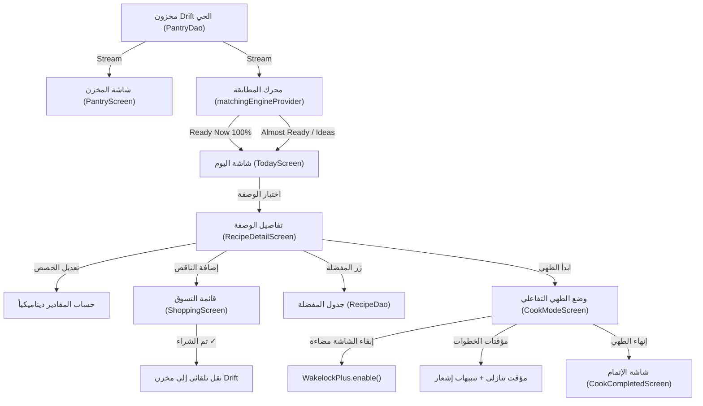

# 📋 خطة تنفيذ المرحلة الرابعة (Sprint 4 Execution Plan)
## ربط الواجهات وتجربة الطهي التفاعلية (UI Wiring, Reactive State & Interactive Cook Mode)

> **المشروع:** تطبيق الطهي الذكي — Smart Cook  
> **المرحلة:** المرحلة الرابعة (Sprint 4: ربط الواجهات والتفاعل الحي)  
> **الهدف:** الانتقال النهائي من واجهات العرض الساكنة (Mock UI) إلى واجهات تفاعلية حية 100% مرتبطة بمحرك المطابقة وقاعدة بيانات Drift SQLite، مع تفعيل تجربة الطهي الكاملة (Wakelock، المؤقتات، الحصص الديناميكية، والتسوق).  
> **المرجع التقني المعتمد:** وثائق [04-core-features.md](file:///d:/My%20Work/Flutter%20Projects/food%20app/smart-cook-analysis/build-plan/04-core-features.md) و [05-recipe-and-cook-mode.md](file:///d:/My%20Work/Flutter%20Projects/food%20app/smart-cook-analysis/build-plan/05-recipe-and-cook-mode.md).

---

## 🧭 خريطة تدفق البيانات والتفاعل الحي (Data Flow & Screen Interactions)

---

## 📝 تفصيل المهام التنفيذية الست (The 6 Execution Steps)

### 1️⃣ الخطوة 4.1: ربط شاشة المخزن الحي وإدارته الذكية (Pantry Wiring)
- **الملفات المستهدفة:**
  - `lib/presentation/providers/pantry_provider.dart`
  - `lib/presentation/screens/pantry_screen.dart`
- **المهام:**
  - ترقية `pantryProvider` للاعتماد على `StreamProvider` من `PantryDao` في Drift SQLite لضمان المزامنة الفورية مع القرص.
  - إتاحة إضافة المكونات يدوياً أو دفعة واحدة أو بالصوت عبر `ArabicNormalizer.extractIngredientNames()`.
  - دعم التبويب حسب الفئات (خضروات، لحوم، ألبان، بهارات) مع عداد حي للمكونات المتوفرة.
  - إمكانية الحذف بالسحب (`Dismissible`) وتحديد مكان التخزين (ثلاجة / مجمد / رف).

---

### 2️⃣ الخطوة 4.2: ربط شاشة اقتراحات اليوم بمحرك المطابقة (Today & Discover Wiring)
- **الملفات المستهدفة:**
  - `lib/presentation/screens/today_screen.dart`
  - `lib/presentation/screens/discover_screen.dart`
- **المهام:**
  - استبدال المطابقة الساكنة بالربط مع `matchingEngineProvider` و `readyNowMatchesProvider` و `almostReadyMatchesProvider`.
  - ربط شيت الفلاتر `FiltersBottomSheet` بـ `matchFiltersProvider` لتحديث الاقتراحات فورياً (الوقت، الصعوبة، والمطابخ).
  - عرض بطاقات الوصفات مع شارات التغطية الملونة:
    - 🟢 **جاهز للطهي (100%):** كل المكونات في مطبخك الآن.
    - 🟠 **ينقصك القليل:** إبراز اسم المكون الناقص بالاسم وزر بنقرة واحدة لإضافته لقائمة التسوق.
  - عرض شاشة فارغة إرشادية جذابة عندما يكون المخزن فارغاً لتوجيه المستخدم لإضافة مكونات.

---

### 3️⃣ الخطوة 4.3: شاشة تفاصيل الوصفة والمقادير التفاعلية (Recipe Detail & Servings Scaler)
- **الملف المستهدف:**
  - `lib/presentation/screens/recipe_detail_screen.dart`
- **المهام:**
  - تحميل تفاصيل الوصفة ومكوناتها بدقة عبر المعرف `recipeId`.
  - **مضاعف الحصص الديناميكي (Servings Multiplier):** عند زيادة عدد الأفراد من 2 إلى 4، يتم ضرب مقادير الجرامات والملاعق تلقائياً وإعادة حساب السعرات.
  - تمييز حالة كل مكون (متوفر في مطبخك ➔ أيقونة خضراء ✓ / غير متوفر ➔ زر إضافة للتسوق).
  - تفعيل زر المفضلة التفاعلي مع الحفظ المستمر في قاعدة بيانات Drift عبر `recipeDao.toggleFavorite()`.

---

### 4️⃣ الخطوة 4.4: وضع الطهي التفاعلي الكامل وإبقاء الشاشة مضاءة (Interactive Cook Mode)
- **الملف المستهدف:**
  - `lib/presentation/screens/cook_mode_screen.dart`
  - `lib/presentation/screens/cook_completed_screen.dart`
- **المهام:**
  - تشغيل `WakelockPlus.enable()` فور فتح شاشة الطهي لمنع إغلاق الشاشة أثناء انشغال يدي المستخدم بالطهي، وإلغاؤها عند الخروج `WakelockPlus.disable()`.
  - مؤقتات تنازلية حية لكل خطوة تحتوي على وقت (`timerSeconds`) مع أزرار (بدء / إيقاف مؤقت / إعادة تعيين).
  - إصدار تنبيه محلي عبر `flutter_local_notifications` وصوت تنبيه عند انتهاء وقت الخطوة.
  - الانتقال التدريجي خطوة بخطوة مع مؤشر تقدم دائري/خطي وصولاً لشاشة الإتمام الاحتفالية.

---

### 5️⃣ الخطوة 4.5: ربط قائمة التسوق التفاعلية (Shopping List & Auto-Transfer)
- **الملف المستهدف:**
  - `lib/presentation/screens/shopping_screen.dart`
- **المهام:**
  - ربط شاشة التسوق بـ `ShoppingDao` في Drift لقراءة وإضافة المكونات الناقصة.
  - إمكانية إضافة جميع المكونات الناقصة لأي وصفة بضغطة زر واحدة.
  - خانات اختيار تفاعلية لكل بند (`Checkbox`).
  - **الميزة السحرية (نقل المشتريات للمخزن):** زر *"نقل المكتمل إلى مخزني"* يقوم بنقل العناصر المحددة تلقائياً إلى جدول المخزن وحذفها من التسوق فوراً.

---

### 6️⃣ الخطوة 4.6: الاختبارات التكاملية الشاملة وضمان الجودة (Integration Tests & DoD)
- **الملف المستهدف:**
  - `test/presentation/cooking_flow_test.dart`
- **المهام:**
  - اختبار سيناريو المستخدم الواقعي الكامل (End-to-End Flow):
    1. إضافة مكونات إلى المخزن (بيض، طماطم).
    2. التحقق من ظهور "الشكشوكة" في قائمة الوصفات الجاهزة 100%.
    3. الدخول إلى شاشة التفاصيل وتغيير الحصص.
    4. الانتقال إلى وضع الطهي وإنهاء الوصفة.
  - فحص `flutter test` لضمان نجاح كافة الاختبارات.
  - فحص `flutter analyze` بنتيجة خالية من أي أخطاء.

---

## ⏱️ الجدول الزمني المقترح لـ Sprint 4

| الخطوة | المهمة الرئيسية | المخرجات البرمجية |
|:------:|:----------------|:------------------|
| **4.1** | ربط المخزن الحي | `pantry_provider.dart`, `pantry_screen.dart` |
| **4.2** | ربط الاقتراحات ومحرك المطابقة | `today_screen.dart`, `discover_screen.dart` |
| **4.3** | تفاصيل الوصفة ومضاعف الحصص | `recipe_detail_screen.dart` |
| **4.4** | وضع الطهي و Wakelock والمؤقتات | `cook_mode_screen.dart`, `cook_completed_screen.dart` |
| **4.5** | قائمة التسوق والنقل التلقائي للمخزن | `shopping_screen.dart` |
| **4.6** | الاختبارات والتحقق الشامل | `test/presentation/cooking_flow_test.dart` |

---

## ✅ معايير القبول واكتمال المرحلة (Definition of Done)
1. زوال أي أثر للبيانات الساكنة المعزولة في الشاشات الرئيسية، واعتماد Drift SQLite ومحرك المطابقة كمصدر وحيد للحقيقة.
2. الشاشة تبقى مضاءة طوال وضع الطهي وتعمل المؤقتات التنازلية بدقة.
3. تغير محتويات المخزن ينعكس في نفس اللحظة على اقتراحات شاشة اليوم بدون الحاجة لإعادة تشغيل التطبيق.
4. ميزة نقل المشتريات من التسوق إلى المخزن تعمل بسلاسة وبضغطة زر.
5. اجتياز اختبارات الوحدة والتكامل، وتحقيق `flutter analyze: No issues found!`.
